<div align="center">



# 🧮 Revisa Aí

**Aulas de revisão rápidas, claras e interativas para o celular.**
Explicação simples ➜ passo a passo animado ➜ exercícios no caderno ➜ certificado. 🎓

[](https://thiago-spba.github.io/revisa-ai/)


</div>

---

## 📖 O que é

O **Revisa Aí** é um site de arquivo único (`index.html`) criado para as **aulas remotas** do **Prof. Thiago Fernando**, Licenciado em Matemática, da **Escola Estadual Moacyr Amaral**.

Ele foi pensado para pré-adolescentes: frases curtas, exemplos do dia a dia e tudo explicado antes de ser usado. O aluno escolhe a turma, aprende, pratica no caderno e, no final, gera o seu certificado de revisão.

## 🎒 Turmas

| Turma | Disciplina | Tema da revisão | Cor |
|:---:|---|---|:---:|
| **7ºB** | Educação Financeira | Porcentagem, desconto e juros | 🟠 |
| **1ºA** | Robótica | Circuito, resistor e sensor | 🔵 |
| **1ºB** | Orientação de Estudos de Matemática | Equação do 1º grau | 🟣 |
| **8ºA** | Orientação de Estudos de Matemática | Frações e números decimais | 🟢 |

> 🔓 Todas as aulas ficam abertas: o aluno pode entrar também nas outras turmas.

## ✨ Recursos

- 💡 **Aula simples:** começa com uma situação do dia a dia e traz três blocos: *O que é*, *Como fazer* e *Cuidado com este erro*.
- 🎬 **Passo a passo animado:** cada passo aparece com um toque, um de cada vez.
- ✏️ **Pratique no caderno:** 6 exercícios por turma, do fácil ao desafio.
- 👁️ **Olhinho:** a solução explicada e a resposta ficam escondidas até o aluno querer ver.
- ▶️ **Vídeos:** botões que abrem buscas no YouTube para tirar dúvidas.
- 🎓 **Certificado de revisão:** cada turma tem o seu, com cor, símbolo, assuntos e frase motivacional. Dá para **baixar em imagem (PNG)** ou tirar um print.
- ⚠️ **Avisos importantes:** lembrete da tarefa na **Sala do Futuro** (que gera a nota do bimestre) e da plataforma da turma (**Matific** ou **Academic**).
- 📱 **Responsivo:** testado de 320 px (celular pequeno) a 1280 px (computador).
- 🎨 **Visual confortável:** fundo creme acinzentado e cores vivas que não cansam os olhos.

## 🔗 Links diretos por turma

Dá para mandar o link direto da aula pelo WhatsApp:

| Turma | Endereço |
|:---:|---|
| 7ºB | `https://thiago-spba.github.io/revisa-ai/#7b` |
| 1ºA | `https://thiago-spba.github.io/revisa-ai/#1a` |
| 1ºB | `https://thiago-spba.github.io/revisa-ai/#1b` |
| 8ºA | `https://thiago-spba.github.io/revisa-ai/#8a` |

## 🔒 Privacidade

O nome digitado para o certificado **não é enviado nem guardado**: ele aparece só na tela do aluno. O site não usa cookies, cadastro nem rastreamento.

## 🛠️ Tecnologias

- **HTML5 + CSS3 + JavaScript puro**, em um único arquivo.
- **Canvas 2D** para desenhar o certificado em imagem.
- **SVG** para as figuras das aulas.
- **GitHub Pages** para a hospedagem.

## 🗂️ Estrutura

```text
revisa-ai/
├── index.html   # o site inteiro (aulas, exercícios e certificado)
├── banner.svg   # banner animado deste README
└── README.md    # você está aqui 👋
```

## 🧪 Como rodar no computador

1. Baixe ou clone o repositório.
2. Abra o arquivo `index.html` no navegador.

Pronto! Não precisa instalar nada. ✅

## 👨‍🏫 Autor

**Prof. Thiago Fernando**
Licenciado em Matemática · Escola Estadual Moacyr Amaral

<div align="center">

*Feito com 💙 para ajudar cada aluno a aprender no seu ritmo.*

</div>
